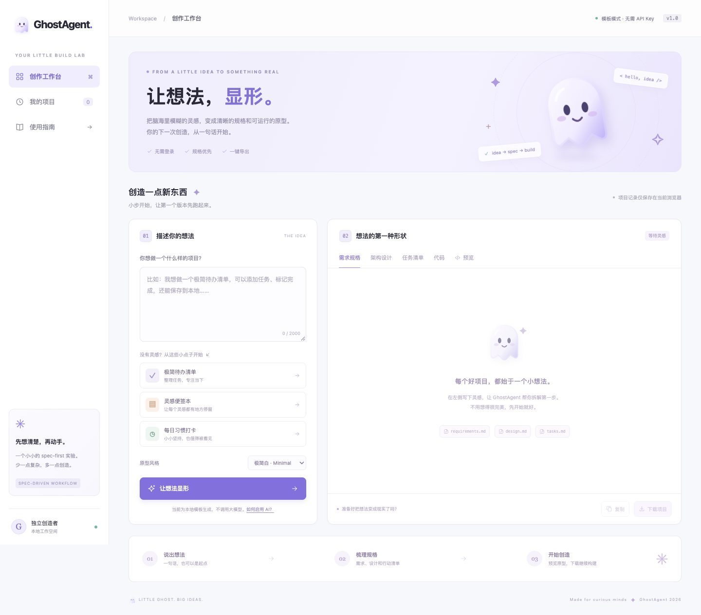

# 👻 GhostAgent

**让想法，显形。** 一个轻量的 spec-first 网页工具：输入一句想法，生成需求规格、架构设计、任务清单和可交互的 Web 原型。

基于提供的[对话](https://www.doubao.com/thread/x5DYoklUkFigLBVyT)实现，优先做成小而完整的演示项目。**零运行依赖、零构建步骤、默认无需 API Key。**



## 能做什么

- 输入想法，或选择「极简待办」「灵感便签」「习惯打卡」三个示例。
- 生成 `requirements.md`、`design.md`、`tasks.md`。
- 查看代码，直接在隔离预览中添加记录、搜索便签或打卡。
- 选择极简白 / 午夜紫 / 森系绿三种原型配色。
- 一键下载 ZIP：单文件原型、README、`.kiro/specs/` 和 steering 规则。
- 浏览器本地保存最近 8 个项目，可重新打开、下载、删除或清空。
- 可选接入兼容 OpenAI Chat Completions 的模型服务，**密钥仅存于本地服务器**。

## 30 秒本地启动

需要 **Node.js 22 或更高版本**，无需 `npm install`：

```bash
npm start
```

打开 **http://127.0.0.1:4173**。按 `Ctrl+C` 停止。

也可仅使用 Python 静态服务（只有模板模式）：

```bash
python3 -m http.server 4173 --bind 127.0.0.1
```

请通过 HTTP 服务打开，而非双击 HTML：浏览器通常限制 `file://` 下的 ES 模块加载。

### 一次完整试用

1. 点击「极简待办清单」→「让想法显形」。
2. 在五个标签页中查看规格、任务和代码。
3. 点击「预览」，新增、完成、删除任务。
4. 点击「下载项目」，解压 ZIP。
5. 在解压目录运行 `python3 -m http.server 8080`，打开 http://localhost:8080。
6. 新增任务并刷新，检查持久化；再在 Kiro 中打开该目录，审阅规格并继续实现。

**预览是无同源权限的隔离沙箱，本地存储可能不可用，因此会提示临时会话。这是预期行为。持久化请在下载后的 HTTP 原型中验证。**

## 两种模式，明确区分

| 模式 | 需求来源 | 可运行代码来源 | API Key |
| --- | --- | --- | --- |
| 默认模板模式 | 本地规则，保留原始输入并标注假设 | 本地预置模板 | 不需要 |
| 可选 AI 模式 | 模型返回、通过结构校验的需求计划 | 仍为本地预置模板 | 仅配置在服务器 |

这不是一个能完成任意全栈项目的自主 Agent。当前只有三个专用前端原型；未知想法会明确降级为通用清单。登录、支付、云同步、数据库和额外业务功能均需继续开发。AI 目标需求不代表代码已经实现对应功能。

### 启用真实 AI 需求整理（可选）

```bash
cp .env.example .env
# 用编辑器填写 .env，再启动 / 重启服务
npm start
```

`.env` 参数：

```dotenv
AI_BASE_URL=https://api.openai.com/v1
AI_API_KEY=填写你的密钥
AI_MODEL=填写你有权限使用的模型名
PORT=4173
```

- 基地址以 `/v1` 结尾，不要重复填写 `/chat/completions`。接口需支持 `response_format: {type: "json_object"}`。
- `.env.example` 的模型名只是示例，请按供应商实际支持情况填写。
- 若使用本地模型，可配置 `http://127.0.0.1:端口/v1`；若不需要鉴权，可填一个非空占位值以启用 AI 模式。
- 页面右上角会显示 AI 模式；AI 出错时明确报错，不静默伪装成成功。
- 密钥不下发到浏览器、不写入 localStorage、不放入下载包。
- 启用 AI 后输入将发给你配置的模型服务；请自行确认该服务的隐私规则。
- 本地服务仅监听 `127.0.0.1`，为个人演示设计；不直接用于公共多用户 AI 服务。

## GitHub Pages 部署

将**本目录的内容**作为 GitHub 仓库根目录，而不是把外层工作区的清理日志等资料一起上传。

1. 把源码提交到对话中计划使用的仓库：`https://github.com/simpson007/GhostAgent`。
2. 打开仓库 **Settings → Pages → Build and deployment → Source → GitHub Actions**。
3. 推送 `main` 分支，或手动运行 **Actions → Test and deploy GitHub Pages**。
4. 工作流先执行测试，再仅上传 HTML/CSS/JS 和图标。`.env` 与服务器代码不进入部署包。
5. Actions 成功后，预计页面地址为 **https://simpson007.github.io/GhostAgent/**。只有实际部署并验证后才视为可用。

也可在 Pages 中选择 **Deploy from a branch → main → /(root)**，无需 Actions 构建。所有资源均使用相对路径，兼容 `/GhostAgent/` 子路径。

**GitHub Pages 只有静态前端，因此线上默认是明确标注的模板模式；它不会托管 Node 代理，也不应存放 API 密钥。**

本次交付不包含向 GitHub 推送、开启 Pages 或核验比赛资格；对话中的赛事规则也未作为已验证事实采用。

## 在 Kiro 中继续开发

项目根目录和下载包都带 `.kiro`：

```text
.kiro/
├── steering/
│   ├── product.md
│   └── tech.md
└── specs/ghostagent/
    ├── requirements.md
    ├── design.md
    └── tasks.md
```

在 Kiro 中打开项目，先审阅规格，再选一个未完成任务。可以输入：

> 请阅读 .kiro 下的 steering 和 ghostagent specs。先核对需求与当前实现的差异，再根据 tasks.md 完成一个最小任务，运行测试并说明修改。不要扩展成复杂平台。

**这些文件是为 Kiro 工作流准备的交付物，并不代表网页运行时调用 Kiro，也不代表本次开发已经在 Kiro 中完成。** 参赛时应真实使用 Kiro，保留迭代记录，再据实填写开发过程。参赛介绍与录屏提纲见 [docs/DEMO.md](docs/DEMO.md)。

## 测试

```bash
npm test
```

使用 Node 内置测试器，无需安装测试框架。覆盖输入边界、三类原型脚本、主题、内容转义、AI 结构校验、ZIP/CRC、HTTP 路由、私有文件保护、跨域请求和 AI 代理的模拟响应。测试不会消耗模型额度。

浏览器验收记录见 [docs/TESTING.md](docs/TESTING.md)。真实供应商 AI 连通性需配置你自己的密钥后再验证；自动化测试使用模拟响应。

## 文件一览

```text
index.html             页面结构
styles.css             响应式样式
app.js                 交互、预览、项目历史
generator.js           规格与可运行原型生成
zip.js                 无依赖 ZIP 导出
server.mjs             可选本地 AI 代理和静态服务
assets/ghost.svg       原创 SVG 小幽灵图标
.kiro/                 规格与 steering 文件
.github/workflows/     测试与 Pages 部署
tests/                 Node 单元测试与 API 集成测试
docs/                  截图、演示提纲与验收说明
```

MIT License.
